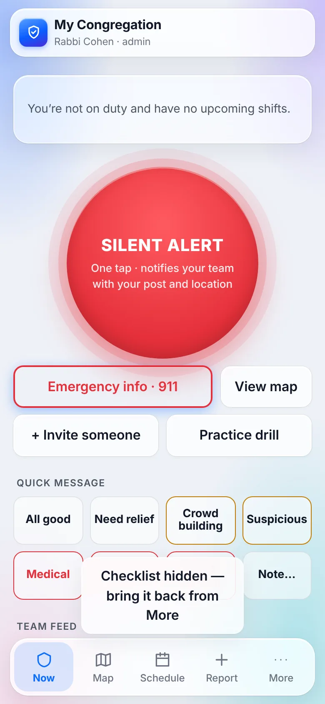
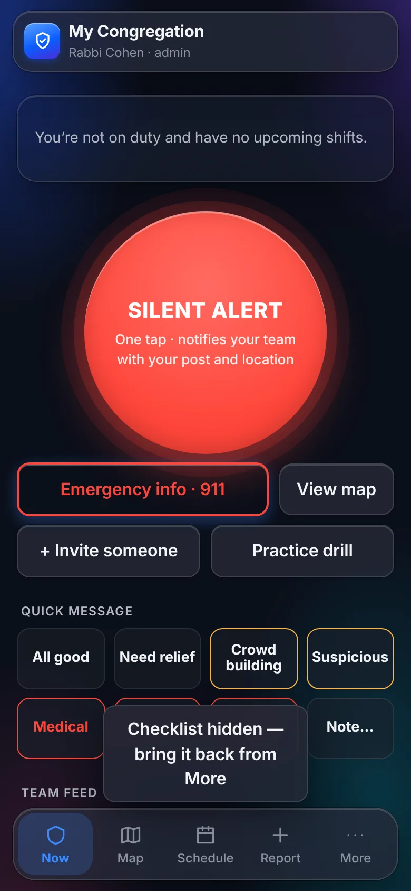
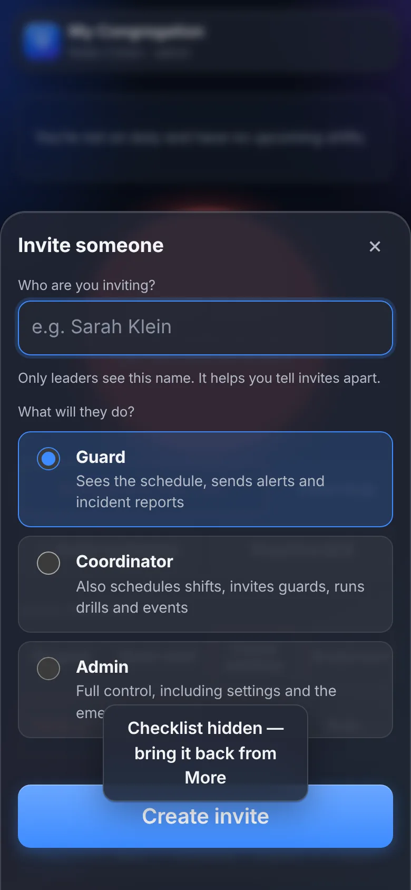

# Mishmar Guard Watch

[](https://github.com/generalwax2018/mishmar/actions/workflows/test.yml)
[](LICENSE)

Free, open-source, mobile-first app for **house-of-worship security teams**. It's built for volunteer guards at synagogues, churches, mosques and temples:

- scheduling
- a one-tap silent alert
- quick team messages
- incident reports with photos
- building layout surveys
- outdoor event mode with live team positions
- an optional **Shabbat / Yom Tov lock**

<p>



</p>

> **Mishmar does not replace 911.** It coordinates your team. In an emergency, call emergency services first. Test alert delivery on your team's real phones before you rely on it.

It is one Node process and one SQLite file. There's no tracking, no ads, and no third-party services. It installs to the Home Screen like an app.

## Run it

```bash
npm install
npm start            # http://localhost:3000
npm test             # 114 end-to-end checks
```

Requires **Node 22+**. On first run the terminal prints a one-time **admin invite code**. Open the app, tap "I have an invite code", and create the first admin. The code works with or without the hyphen. Each restart before an account exists prints a new code and cancels the old one.

**Server commands** (run in the project folder, even while the app is running):
- `npm run invite`: prints a one-time **admin** invite code. Use `npm run invite -- guard` or `-- coordinator` for other roles.
- `npm run reset-login -- <login>`: prints a one-time password reset code for that login. Use this if you're locked out; it also turns off two-step sign-in.

**Local development:** set `MISHMAR_INSECURE_COOKIES=1` when running over plain `http://` on a phone or tunnel. To simulate Shabbat on a weekday, set `MISHMAR_FAKE_NOW=2026-11-06T23:00:00Z`. Never set either in production.

**Production:**
- Serve over HTTPS. It's required for install, push, camera and geolocation.
- Set `MISHMAR_MASTER_KEY` (32 random bytes, base64) from a secrets manager.
- Set `VAPID_SUBJECT=mailto:you@yourshul.org`.
- Set `TRUST_PROXY` if you run behind a proxy.
- Back up `data/` and keep the key separately.

Optional: set `MAP_TILE_URL` to point at your own or a commercial tile server.

## First-time setup (admin)

1. **More › Shabbat / Yom Tov lock & maps:** congregation location, time zone, zmanim, whether to allow street maps.
2. **More › Emergency card:** address, what to say to 911, procedures and contacts.
3. **Invite your team:** tap **+ Invite someone** on the Now screen. Type who it's for, pick their role, then text it, show the QR code, or print it. Codes waiting to be used are listed under **More › Team & posts**, where you can show one again or cancel it.
4. **Map › Edit layout:** photograph the posted evacuation map, then walk the building (see below).
5. **Schedule:** assign shifts. Guards confirm their Shabbat shifts from the Now screen.

## Features

### Now screen
- **Shift or event card:** your current post or zone, radio channel and lead. During events it also has the check-in timer, briefing, and the location-sharing toggle.
- **Silent alert:** one tap. It's stamped automatically with your **post or zone** (more reliable than indoor GPS) plus GPS when available. After sending you can add a type: Medical, Threat/lockdown, Suspicious person, Backup, Fire, Lost child.
- **Escalation:** if nobody taps "I'm responding" within 60 seconds, the alert widens to the whole active team.
- **Nearest responders:** at events, leads see who is closest and how far away.
- **Quick messages:** All good, Need relief, Crowd building, Suspicious, Medical, Lost child, Need backup, Note. Each is stamped with your zone and feeds a team timeline. Urgent ones push to phones with a distinct vibration pattern per urgency, so guards can tell what arrived without looking.
- **Emergency info:** a Call 911 button, the dispatcher script, contacts, procedures, the list of exits and equipment, and the floor plan.
- **Shabbat readiness:** about a day before candle lighting, guards are asked to confirm their shifts and coordinators are told about uncovered posts.

### Building layout & camera survey
- **Base map:** photograph the evacuation map posted in your building, or upload a floor plan.
- **Walk-through survey:** at each entrance, exit, AED, first-aid kit, camera or blind spot, take a photo, or a **panorama** using the phone camera's Pano mode, then tap where you're standing. The photo is attached to that pin or post, and panoramas open in a swipe-to-look viewer.
- **Pin types:** door, exit, AED, first-aid/bleed kit, rally point, fire equipment, stairs, camera, hazard, note. Posts are placed on the plan, so alerts show exactly where someone is.
- **List view:** for bright sun or a weak signal.

The app does not automatically build a 3D model or floor plan from panoramas. A browser app can't do that reliably. A future native iOS app could use Apple's RoomPlan, which needs a LiDAR-equipped iPhone.

### Outdoor event mode (Chanukah lighting, parade, festival)
- **Setup:** an event has a place, start and end, lead, radio channel, briefing, and contacts (police detail, EMS, organizer).
- **Zones:** Stage, North barricade, or parade route segments. Each zone has its own radio channel and zone lead. People are assigned to zones.
- **Base map:** a street map (OpenStreetMap) **or** an uploaded site map. An uploaded map can be **GPS-calibrated** with two reference points so live positions line up.
- **Live team positions:**
  - **Opt-in:** each guard chooses to share.
  - **Visibility per event:** leads only, the whole event team, or off.
  - **Retention:** only the latest point is kept, and it's deleted automatically when the event ends.
  - **Limitation:** sharing works while the app is open (a web-app limitation).
- **Lead roster:** who has read the briefing, last seen, who's sharing, and late check-ins highlighted.
- **Outdoor display mode** (More › Display): high contrast for sunlight, bigger buttons for gloves, and the screen stays awake during a live event.
- **Faith-neutral:** churches and other communities simply leave the Shabbat lock off.

### Shabbat / Yom Tov lock
- **Calculation:** computed offline with Hebcal from the congregation's location, candle lighting to Havdalah. Yom Tov is included, and consecutive days merge into one lock.
- **Enforced on the server:** every routine request is refused with `423`, even for admins, and the lock can't be switched off while it's active.
- **Still available during the lock:** silent alerts (with types), acknowledge, all-clear, the live alert stream, push registration, sign-in, the **emergency card** and the **read-only floor plan**.
- **Locked:** scheduling, reports, messages, events, layout edits and positions.

Please have your rabbi review the zmanim and which functions stay available.

## Security model

| Area | What it does |
|---|---|
| Roles | **guard:** schedule, alerts, messages, own reports, view layout. **coordinator:** + scheduling, layout and survey, events, all incidents, alert history, invite guards. **admin:** + settings, roles, emergency card, delete reports. Checked on the server for every route. |
| No directory | Guards see only display names on the schedule and their own event. Event data is visible only to that event's team. Accounts are invite-only. |
| Minimal data | Name, login and password hash. No email or phone numbers. Alert GPS is deleted after 14 days, alerts after 90, messages after 7 days, event positions when the event ends, incidents after 365 days. |
| Encryption at rest | AES-256-GCM with per-purpose keys covers incident text, alert locations, live positions, messages, briefings, event and emergency contacts, GPS calibration, push subscriptions, **all photos** (incidents, floor plans, survey photos and panoramas). Photo metadata (EXIF/GPS) is stripped in the browser and again on the server. |
| Auth | scrypt hashes, 10+ character passwords, hashed session tokens, HttpOnly + SameSite=Strict + Secure cookies, lockout plus rate limits, sessions revoked on password change or deactivation. |
| Web | Strict CSP with no inline script or style. Leaflet is self-hosted. Map tiles are the only third-party request, allowed only while an admin has street maps enabled. CSRF header required on writes, `no-store` on the API, and the service worker never caches data. |
| Layout sensitivity | Floor plans and survey photos would help an attacker plan. They're encrypted, team-only, never cached offline, and coordinators are reminded not to share screenshots. |

## Release readiness features

- **Practice drills:** coordinators send a clearly labelled DRILL alert through the real alert path (More › Run a practice drill, or the link on Now). Alert history records time to first response. Drills are blocked during the Shabbat / Yom Tov lock.
- **Delivery receipts:** after any alert the sender sees how many teammates had the app open, how many get a notification, and how many can't be reached right now.
- **Connection watchdog:** the server sends a heartbeat every 25 s. If the phone hears nothing for 60 s, or goes offline, a red banner says alerts may not reach it.
- **Alert retries:** a failed send retries automatically for up to 90 s. The server ignores duplicates for 2 minutes, so a retry never creates a second alert.
- **Offline reports:** reports written with no signal are kept on the phone and sent on reconnect. They're deleted from the phone once delivered, or at sign-out.
- **Account recovery:** coordinators (for guards) and admins (for anyone) issue a one-time reset code, valid 24 h. Using it also clears two-step sign-in, which covers a lost phone. All the member's other sessions are signed out.
- **Two-step sign-in:** optional authenticator-app codes (TOTP). The secret is encrypted at rest and codes can't be replayed. Strongly recommended for admins and coordinators.
- **Easy invites:** a big "+ Invite someone" button on Now for coordinators and admins; plain-language role choices; one tap to text the invite; waiting invites listed by name so a leader can show a code again or cancel it. Re-showable codes are stored encrypted and wiped once used or expired.
- **QR invites:** invite and reset codes come with a QR link and a printable hand-out sheet. The code travels in the URL fragment, which browsers never send to the server or logs.

## Hosting

The app is one Node process plus a `data/` folder. Any host that runs a container with a persistent disk works.

1. **Build and run:** use the `Dockerfile`. Mount a persistent volume at `/data`.
2. **Set these environment variables:**
   - `MISHMAR_MASTER_KEY`: 32 random bytes, base64. Generate it with `node -e "console.log(require('crypto').randomBytes(32).toString('base64'))"` and keep a copy in a password manager. Without it, backups can't be read.
   - `VAPID_SUBJECT=mailto:you@yourshul.org`
   - `TRUST_PROXY=1` when behind the host's HTTPS proxy.
3. **HTTPS is required.** Most hosts (Fly.io, Render, Railway) provide it automatically.
4. **Uptime monitoring:** point a monitor such as UptimeRobot or Better Stack at `https://your-host/healthz` and alert yourself by text. If the server is down, alerts fail.
5. **Backups:** schedule `npm run backup` (daily or more often) and copy `backups/` off the server. A backup holds the database and the already-encrypted photos, but never the master key.
6. **Run a single instance.** The live-alert connections and rate limits are held in memory.

## Known limits / next steps

- **iPhone silent mode:** a web app can't break through it. Test alerts on real phones. If that's not good enough, a native wrapper (Capacitor) unlocks iOS Critical Alerts, or add a text-message fallback.
- **Single congregation per deployment.** Hosting it for many congregations needs tenant isolation and separate keys per congregation.
- **Two-step sign-in is optional.** A setting to require it for admins and coordinators is a small next step.
- **Reset codes during Shabbat:** issuing them is a routine action, so it's locked. A guard who forgets their password during Shabbat can't get a reset until Havdalah. Decide with your rabbi whether that should change.
- **Push delivery** still needs testing on real phones against Apple and Google push services.

## Contributing

Bug reports, ideas and pull requests are welcome. Start with [CONTRIBUTING.md](CONTRIBUTING.md). Please **never post real floor plans, photos, incident details or member names**, and report security issues privately (see [SECURITY.md](SECURITY.md)).

## License

Copyright (C) 2026 Michael Waxman.

Mishmar is free software. You can redistribute it and/or modify it under the terms of the [GNU Affero General Public License](LICENSE), version 3 or (at your option) any later version.

**If you run a modified copy for others,** the AGPL asks you to offer those users your source. Set `MISHMAR_SOURCE_URL` to your fork, and the app's "Source code" link will point there. Third-party components and their licenses are listed in [THIRD_PARTY.md](THIRD_PARTY.md).

This software comes with no warranty. It is not a substitute for professional security advice, training or emergency services.
